<div align="center">

<sub>CASE STUDY · DRCCMD 2026</sub>

# Visitor and Queue System

**Ministers, delegations and guests all arrived at Palm Spring at the same moment.**<br>
Each of them carried a QR ID card, so a single scan at the door was all it took —<br>
and the lobby screen welcomed them by name.

[](vms-backend/)
[](vms-backend/apps/scans/)
[](vms-dashboard/)
[](vms-scanner/)
[](vms-backend/)
[](vms-desktop/)
[](vms-contracts/)


</div>

---

| | |
|---|---|
| **Event** | Díli Regional Cooperative Conference and Ministerial Dialogue 2026 |
| **Place** | Palm Spring, Díli, Timor-Leste |
| **Date** | 2–3 October 2026 |
| **Medium** | Django, Next.js, React Native, Expo |
| **Studio** | [Inovtec](https://inovtec.digital) |
| **Status** | Used live at the event |

<p align="center">
  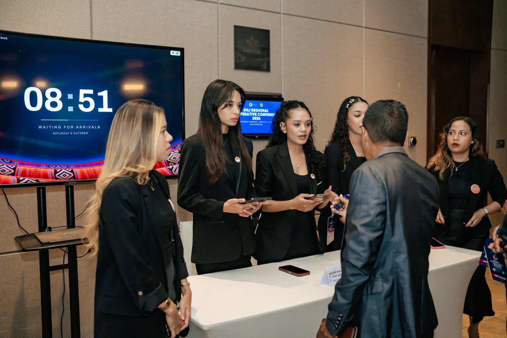
  <br>
  <sub><b>Nº 01</b> — 08:51, the lobby screen, waiting for the first arrivals.</sub>
</p>

---

## The problem

A ministerial dialogue brings many important guests through one entrance in a
very short window. A paper list at the door turns that moment into a queue —
and nobody inside the hall knows who has already arrived.

## How it worked

Two paths at the door, one welcome. Visitors already in the system go
**straight to the scan**; anyone who isn't is registered on the spot.

```
Not yet registered ─▶ I. Register on the spot ─▶ II. QR ID card ─┐
                                                                 ▼
Already registered ────────── straight to the scan ─────▶ III. One scan ─▶ IV. Welcome on screen
```

<table>
  <tr>
    <td width="50%" valign="top">
      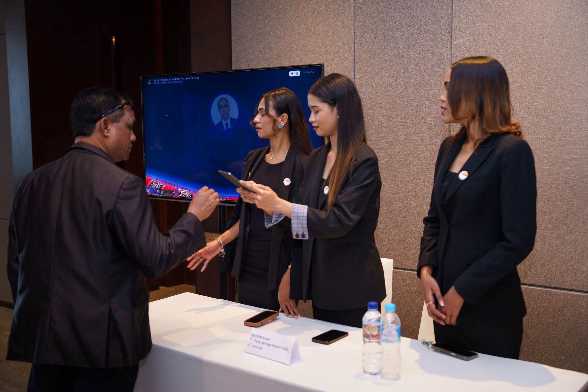
      <h3>I. Register on the spot</h3>
      Anyone not yet in the system is registered at the desk by the welcome
      team — name, country, organisation and a photo — and leaves with a
      working badge.
      <br><sub>The welcome desk at the entrance.</sub>
    </td>
    <td width="50%" valign="top">
      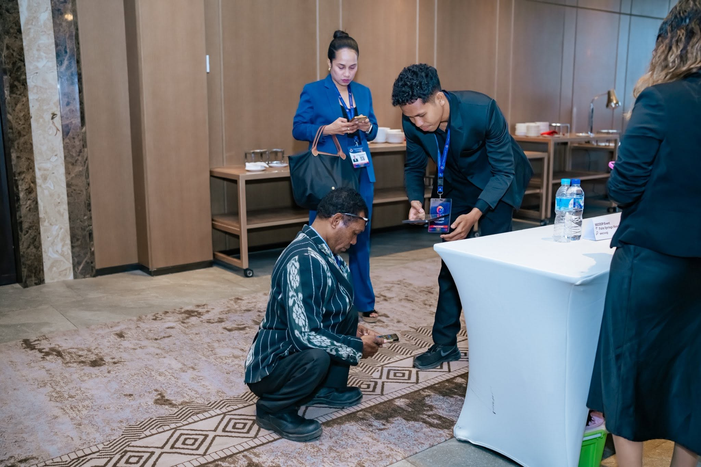
      <h3>II. The QR ID card</h3>
      Every registered visitor carries an ID card with a QR code of their own,
      printed to the organisers' production artwork.
      <br><sub>QR code ID cards.</sub>
    </td>
  </tr>
  <tr>
    <td width="50%" valign="top">
      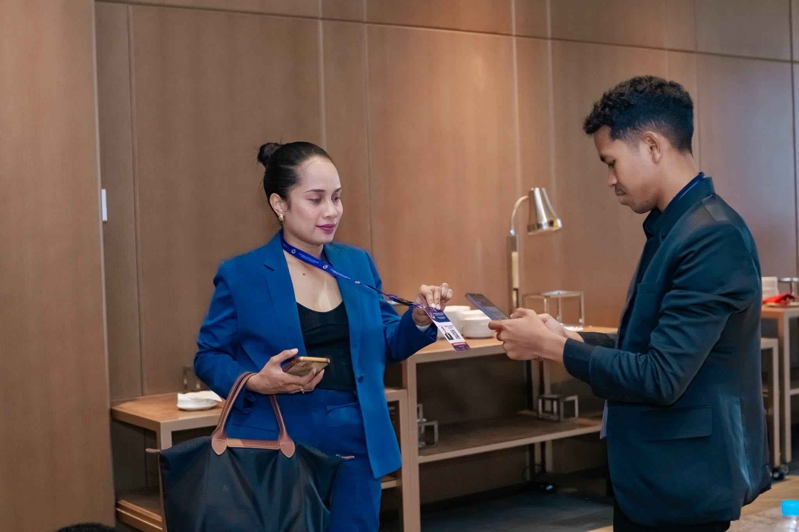
      <h3>III. One scan</h3>
      Registered last week or a minute ago, it makes no difference: a phone
      scans the ID card and the visitor is checked in.
      <br><sub>A phone scans the ID card.</sub>
    </td>
    <td width="50%" valign="top">
      <a href="evidence/juliao-martins-welcome.mp4" title="Open the original MP4">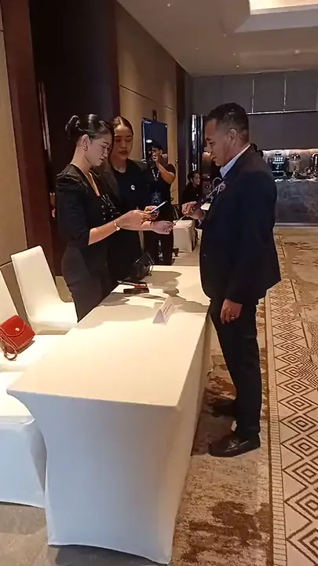</a>
      <h3>IV. Welcome on screen</h3>
      The lobby screen greets the visitor by name and photograph in about
      200 ms, then waits for the next arrival.
      <br><sub>▶ Filmed at the event: scan, then welcome. <a href="evidence/juliao-martins-welcome.mp4">Original MP4</a></sub>
    </td>
  </tr>
</table>

---

## From the floor

Photographs from DRCCMD 2026 at Palm Spring. Click any one to open it full size.

<table>
  <tr>
    <td width="50%"><a href="evidence/juliao-martins-lobby-screen.jpg">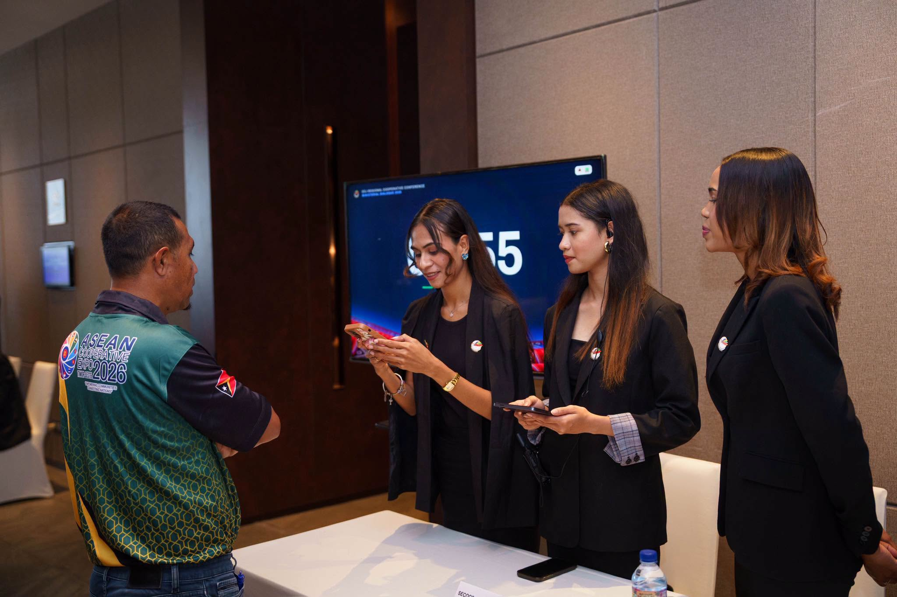</a><br><sub><b>Nº 02</b> — Check-in desk in front of the lobby screen.</sub></td>
    <td width="50%"><a href="evidence/juliao-martins-scan-closeup.jpg"></a><br><sub><b>Nº 03</b> — A delegate's badge scanned at the registration desk.</sub></td>
  </tr>
  <tr>
    <td><a href="evidence/juliao-martins-scan-batik.jpg">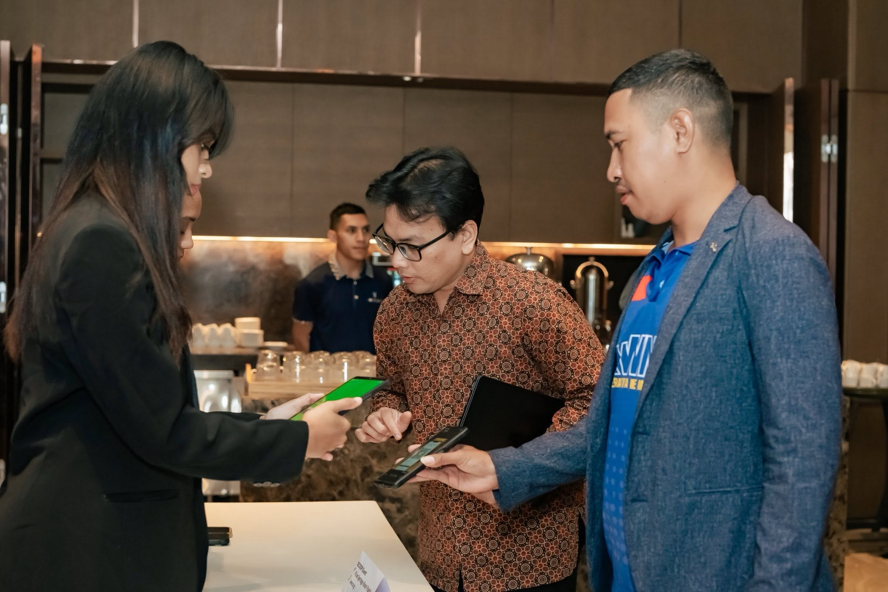</a><br><sub><b>Nº 04</b> — Badge and phone: checked in.</sub></td>
    <td><a href="evidence/juliao-martins-scan-arrival.jpg">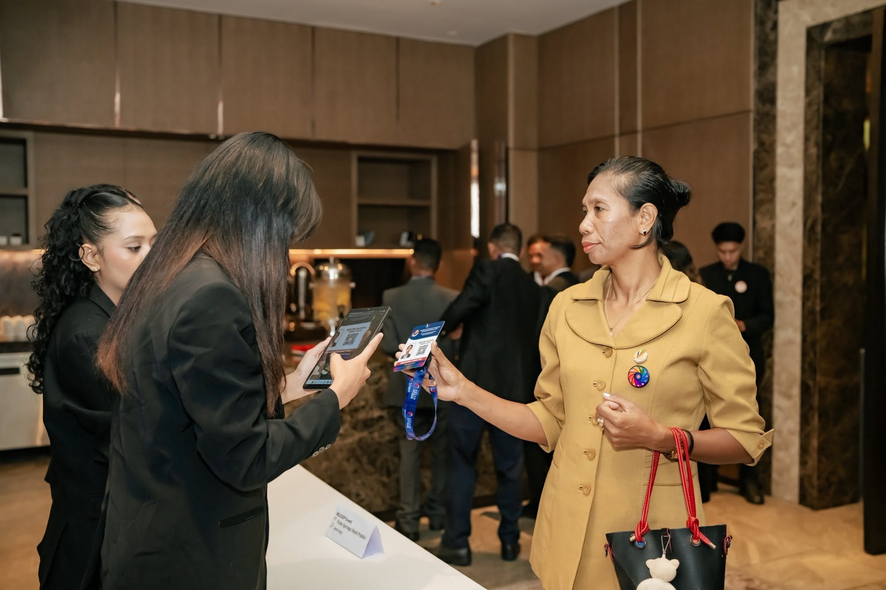</a><br><sub><b>Nº 05</b> — Checking in a delegate on arrival.</sub></td>
  </tr>
  <tr>
    <td><a href="evidence/juliao-martins-scan-desk.jpg">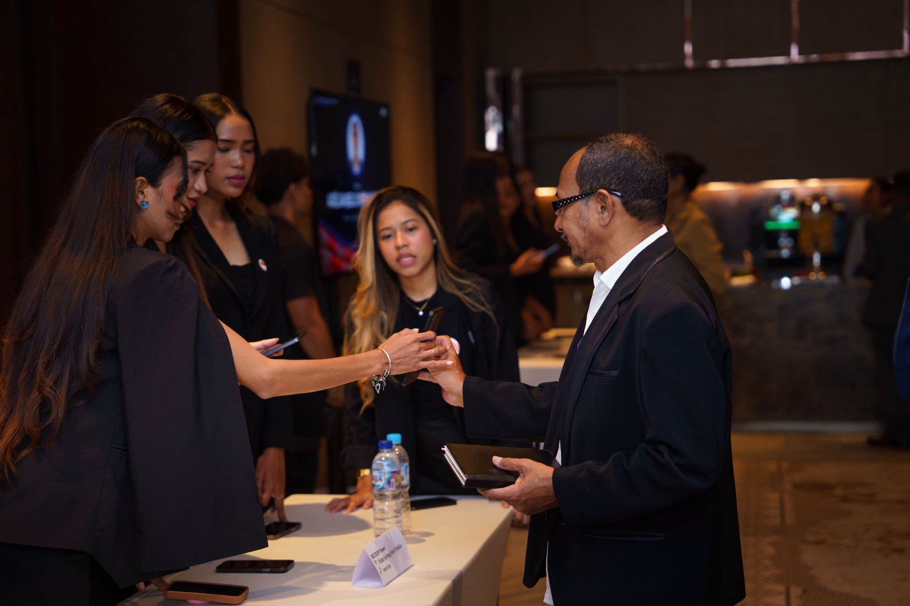</a><br><sub><b>Nº 06</b> — Scanning badges at the door.</sub></td>
    <td><a href="evidence/juliao-martins-drccmd-stage.jpg">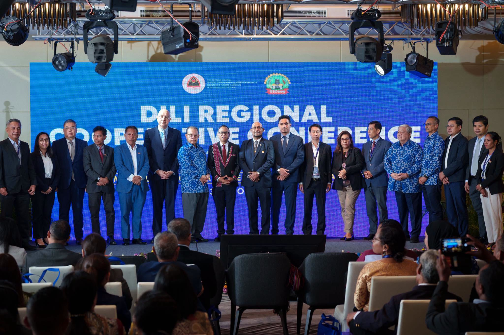</a><br><sub><b>Nº 07</b> — On stage at the Díli Regional Cooperative Conference.</sub></td>
  </tr>
  <tr>
    <td><a href="evidence/juliao-martins-desk-ready.jpg">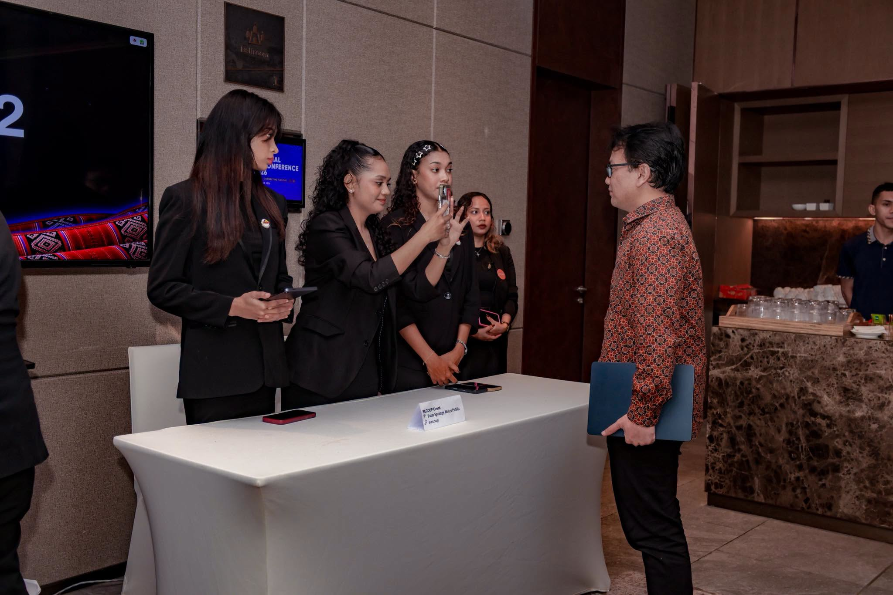</a><br><sub><b>Nº 08</b> — The desk, ready for the next arrival.</sub></td>
    <td><a href="evidence/juliao-martins-scan-queue.jpg">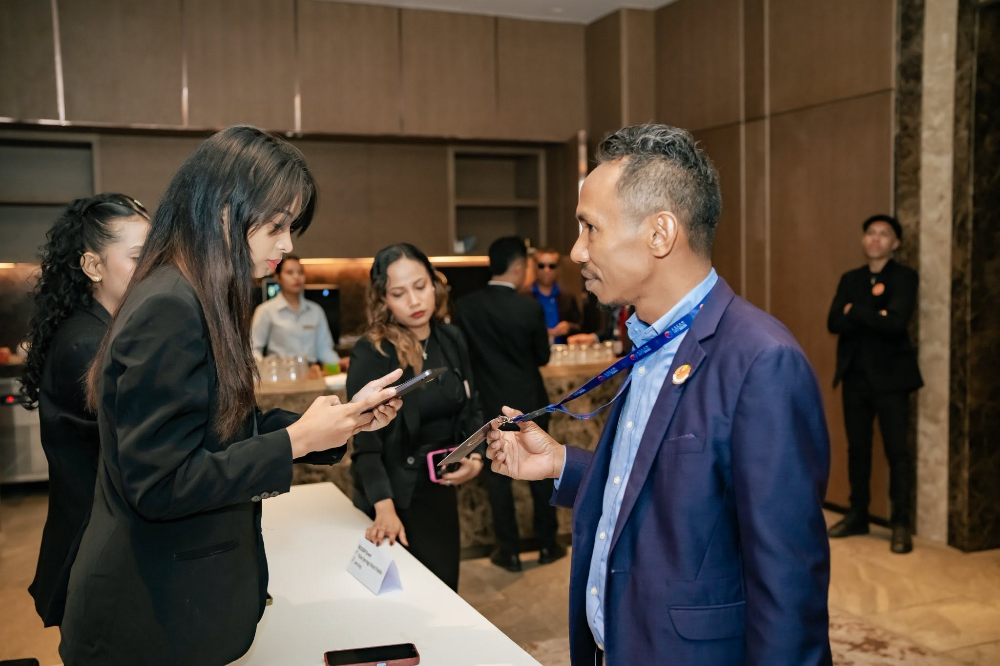</a><br><sub><b>Nº 09</b> — Keeping the line moving.</sub></td>
  </tr>
  <tr>
    <td><a href="evidence/juliao-martins-scan-lounge.jpg">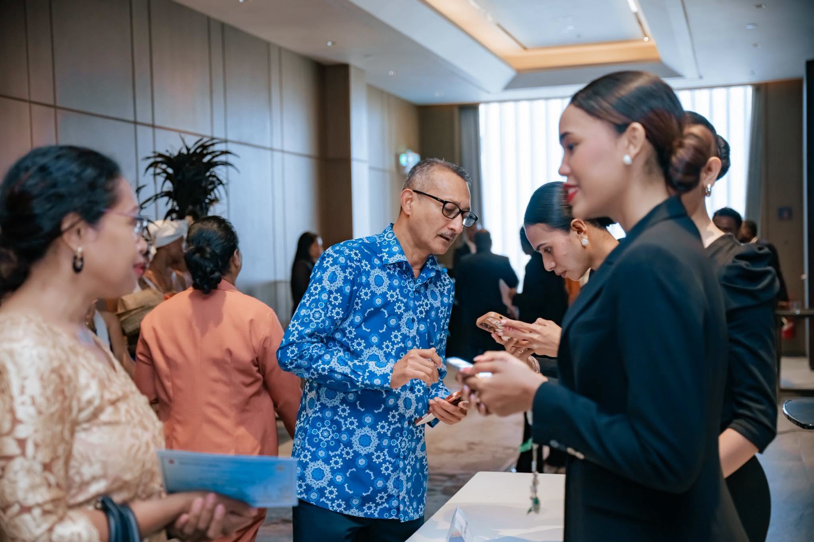</a><br><sub><b>Nº 10</b> — Check-in in the lounge.</sub></td>
    <td><a href="evidence/juliao-martins-asean-expo.jpg"></a><br><sub><b>Nº 11</b> — Alongside the ASEAN Cooperative Expo 2026.</sub></td>
  </tr>
</table>

---

<sub>BEHIND THE SCENES</sub>

## Made by Inovtec

Inovtec, my team, built the Visitor and Queue System and the official DRCCMD
and ASEAN Cooperative Expo website — and ran the system on site for the whole
event.

| | |
|---|---|
| **Studio** | Inovtec |
| **Built** | Visitor and Queue System |
| **Also built** | Official DRCCMD & ACE website |

[**Visit Inovtec →**](https://inovtec.digital) &nbsp;·&nbsp; [**Visit cooptl.com →**](https://cooptl.com/)

<table>
  <tr>
    <td width="50%" valign="top"><br><sub><b>Mission complete</b> — the team with H.E. Arsénio Pereira da Silva, Secretary of State for Cooperatives (SECoop), Timor-Leste.</sub></td>
    <td width="50%" valign="top">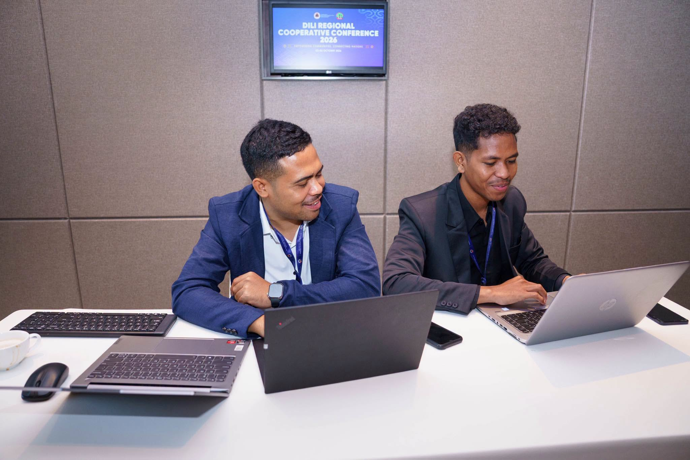<br><sub><b>Behind the scenes</b> — the team running the system during the event.</sub></td>
  </tr>
</table>

---

## Under the hood

Five applications and one generated contract, in a single monorepo, running on a
closed LAN behind one router — no internet, no cloud, no containers.

### Architecture

```
  Admin laptop                Guard phones                 Lobby screen
  ┌──────────────┐            ┌──────────────┐             ┌──────────────┐
  │ vms-dashboard│            │ vms-scanner  │             │  vms-screen  │
  │ Next.js 16   │            │ Expo / RN    │             │ Next.js, GSAP│
  └──────┬───────┘            └──────┬───────┘             └──────┬───────┘
         │ JWT (HTTP)                │ device token                │ device token
         │                           │ POST /scans                 │ WS  /ws/screen/
         ▼                           ▼                             │ GET /screen/feed
  ┌──────────────────────────────────────────────────────────┐     │
  │  vms-backend — Django · DRF · Channels (ASGI, 1 worker)  │◀────┘
  │  write ScanEvent → transaction.on_commit → group_send    │
  └──────────────────────────┬───────────────────────────────┘
                             ▼
                     PostgreSQL (native)

  vms-desktop (PySide6) starts, watches and stops all of the above.
  vms-contracts: OpenAPI → TypeScript types shared by every frontend.
```

### The stack

| Part | Technology |
|---|---|
| **Backend** | Django 6.1, Django REST Framework, SimpleJWT, Django Channels, PostgreSQL |
| **Real-time** | WebSocket push for speed + polling backfill for recovery (`InMemoryChannelLayer`, no Redis) |
| **Admin dashboard** | Next.js 16 (App Router), TypeScript, Tailwind CSS v4, TanStack Query |
| **Guard scanner** | React Native, Expo SDK 57, expo-router, expo-camera, expo-sqlite offline queue |
| **Lobby screen** | Next.js 16, Tailwind CSS v4, GSAP |
| **Control centre** | Python, PySide6 (Qt 6), packaged with PyInstaller |
| **Badges & reports** | ReportLab + qrcode (PDF), openpyxl (Excel) — pure Python |
| **API contract** | drf-spectacular → OpenAPI → openapi-typescript |
| **Languages** | English, Portuguese and Tetun across every interface |

### Engineering highlights

- **Sub-second welcome, with no lost arrivals.** Scans are broadcast over
  WebSocket inside `transaction.on_commit`, so a rolled-back scan never reaches
  the wall. When the socket drops or the server restarts, the screen backfills
  from `/screen/feed?since=<id>` and de-duplicates by event id.
- **Works through a bad network.** Every scan is written to an on-device SQLite
  queue first and synced with backoff, carrying its own timestamp and a
  client-generated idempotency key — a retried scan never becomes two arrivals.
- **Badges that can't be forged, but can be reprinted.** The QR holds an HMAC
  derived token, never a visitor id. It is unguessable, reproducible for
  reprints, and revocable at scan time by deactivating the visitor.
- **No logins at the door.** Scanners, screens and the walk-in desk pair once
  with a 6-character code and hold a scoped, revocable device token.
- **Self-registration from a phone**, with server-side photo sanitising,
  throttling, duplicate flagging and an offline in-browser face check.
- **Print-accurate ID cards.** The card PDF is measured off the organisers'
  production file to within half a millimetre, one card per page for the card
  printer.
- **Reports the organisers can use.** Entrance logs by hour, outcome and device,
  exported as CSV, branded Excel and PDF.
- **One-click event day.** A desktop control centre checks prerequisites,
  starts the four services in order, and only reports a service *ready* once a
  network probe says so.

### Repository layout

```
vms/
├── vms-backend/     Django + DRF + Channels + PostgreSQL
├── vms-dashboard/   Next.js — registration, badges, devices, reports
├── vms-scanner/     React Native + Expo — the guard's camera
├── vms-screen/      Next.js — the lobby welcome wall
├── vms-desktop/     PySide6 — the control centre that starts the rest
├── vms-contracts/   generated TypeScript types (OpenAPI → TS)
└── evidence/        photographs and video from the event
```

### Running it locally

```powershell
# Backend — from vms-backend/ (PostgreSQL running as a native service)
..\.venv\Scripts\python.exe manage.py migrate
..\.venv\Scripts\python.exe manage.py seed_demo
..\.venv\Scripts\python.exe -m uvicorn config.asgi:application --host 0.0.0.0 --port 8000 --workers 1
```

```bash
cd vms-dashboard && npm run dev                  # http://<lan-ip>:3000
cd vms-screen    && npm run dev -- --port 3001
cd vms-scanner   && npx expo start -c
```

Or run `vms-desktop/main.py` and press **Run All**. The backend always runs as
a single worker: the in-memory channel layer lives inside one process.
[`CLAUDE.md`](CLAUDE.md) holds the full design notes and the reasoning behind
every constraint.

---

<div align="center">

**Julião Martins** — turning ideas into reliable digital products.

[Portfolio](https://juliaomartins.dev) · [This case study](https://juliaomartins.dev/projects/visitor-queue-system) · [Inovtec](https://inovtec.digital)

<sub>© 2026 Julião Martins</sub>

</div>
